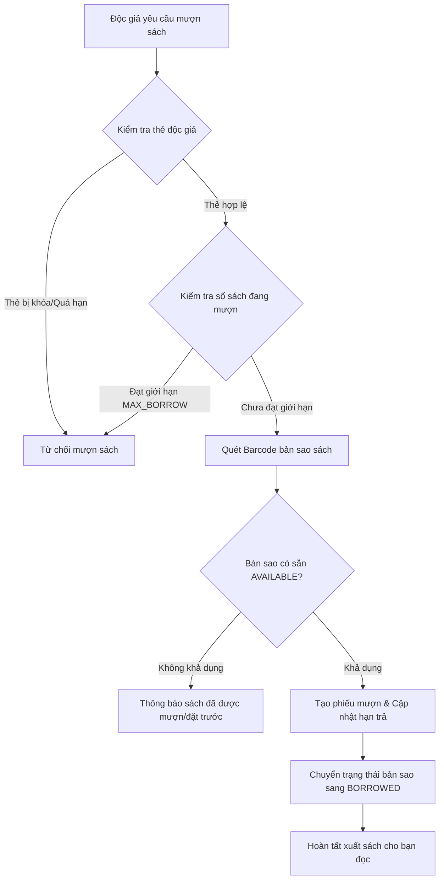

<div align="center">

# 📚 HỆ THỐNG QUẢN LÝ THƯ VIỆN THÔNG MINH
### Smart Library Management System (LMS)
*Phân hệ Ứng dụng Backend Spring Boot 3 & Giao diện Thymeleaf*

[](https://openjdk.org/)
[](https://spring.io/projects/spring-boot)
[](https://spring.io/projects/spring-security)
[](https://www.postgresql.org/)
[](https://www.thymeleaf.org/)
[](https://www.chartjs.org/)

<p align="center">
  <a href="#-tính-năng-nổi-bật">Tính năng</a> •
  <a href="#-công-nghệ-sử-dụng">Công nghệ</a> •
  <a href="#-hướng-dẫn-cài-đặt--chạy-nhanh">Cài đặt nhanh</a> •
  <a href="#-tài-khoản-trải-nghiệm-demo">Tài khoản Demo</a> •
  <a href="#-cấu-trúc-thư-mục">Cấu trúc thư mục</a> •
  <a href="#-quy-trình-nghiệp-vụ">Quy trình nghiệp vụ</a>
</p>

---

</div>

## 📖 Giới thiệu Module

Thư mục **`LibraryManagement/`** chứa toàn bộ mã nguồn ứng dụng quản lý thư viện được xây dựng bằng **Spring Boot 3 (Java 21)**. Ứng dụng được thiết kế theo mô hình **MVC (Model-View-Controller)** chuẩn mực, kết hợp bảo mật phân quyền (RBAC) với Spring Security, quét mã vạch bằng camera, quy trình mượn - trả - gia hạn - đặt trước sách, cùng bảng điều khiển thống kê trực quan.

---

## ✨ Tính năng Nổi bật

### 1. 👥 Phân quyền & Quản trị Tài khoản (RBAC & Authentication)
- **Bảo mật đa tầng:** Sử dụng **Spring Security 6** kết hợp mã hóa mật khẩu một chiều chuẩn **BCrypt**.
- **Phân vai trò người dùng (Roles):**
  - **Quản trị viên (ADMIN):** Quản lý toàn bộ danh mục sách, độc giả, quy trình mượn/trả, báo cáo thống kê và cấu hình quy định thư viện.
  - **Bạn đọc (READER):** Tra cứu kho sách, lọc theo danh mục/tác giả, xem trạng thái khả dụng của từng bản sao, đặt trước (reserve) sách, theo dõi lịch sử và gia hạn thời gian mượn trực tuyến.
- **Quản lý hồ sơ độc giả:** Tạo thẻ bạn đọc (mã bạn đọc, hạn thẻ, thông tin liên lạc, trạng thái hoạt động).

### 2. 📚 Quản lý Danh mục & Bản sao Sách (Book & Copy Management)
- **Tách biệt Đầu sách (Title) & Bản sao vật lý (Book Copy):** Một đầu sách có thể sở hữu nhiều bản sao vật lý tại các kệ sách khác nhau.
- **Mã vạch (Barcode / QR Code) độc lập:** Mỗi bản sao có barcode duy nhất, tình trạng vật lý (Mới, Tốt, Cũ, Hỏng), vị trí lưu kho (kệ sách, tầng).
- **Vòng đời bản sao sách:** Chuyển đổi trạng thái tự động (`AVAILABLE` ➜ `BORROWED` ➜ `RESERVED` ➜ `MAINTENANCE`).

### 3. 📷 Quét Barcode / QR Tức thời bằng Camera
- Hỗ trợ quét mã vạch trực tiếp qua **Camera Laptop/Điện thoại** hoặc máy quét barcode chuyên dụng bằng chuẩn HTML5 WebCam API.
- Tự động nhận diện bản sao sách khi làm thủ tục mượn/trả, giảm thiểu tối đa sai sót nhập liệu thủ công.

### 4. 🔄 Quản lý Lưu thông (Mượn - Trả - Gia hạn - Đặt trước)
- **Lập phiếu mượn:** Kiểm tra tức thì giới hạn mượn của bạn đọc, tình trạng thẻ và tính khả dụng của bản sao sách.
- **Gia hạn trực tuyến:** Độc giả tự yêu cầu gia hạn sách nếu chưa có người đặt trước và chưa vượt quá số lần gia hạn cho phép.
- **Đặt trước (Reservation):** Khi toàn bộ bản sao của một đầu sách đang được mượn, bạn đọc có thể xếp hàng đặt trước. Hệ thống tự động giữ sách khi bản sao được hoàn trả.
- **Kiểm soát quá hạn & Phạt trễ:** Tự động tính số ngày quá hạn và tiền phạt theo ngày dựa trên quy định hệ thống.

### 5. 📊 Bảng điều khiển Thống kê & Báo cáo (Dashboard & Analytics)
- Báo cáo số liệu thời gian thực: Tổng số đầu sách, tổng bản sao, số độc giả, số lượt đang mượn, số lượt quá hạn.
- **Biểu đồ trực quan (Chart.js):**
  - Xu hướng mượn/trả qua các tháng.
  - Tỷ lệ phân bố sách theo các danh mục/thể loại.
  - Top những cuốn sách được mượn nhiều nhất trong năm.

### 6. ⚙️ Cấu hình Quy định Thư viện Linh hoạt (Library Rules)
- Không hardcode luật nghiệp vụ! Quản trị viên có thể tùy biến các thông số hệ thống ngay trên giao diện:
  - *Số lượng sách tối đa được mượn cùng lúc*
  - *Số ngày mượn tiêu chuẩn*
  - *Số ngày gia hạn & số lần gia hạn tối đa*
  - *Thời hạn giữ sách đặt trước*
  - *Mức phí phạt quá hạn (VNĐ/ngày)*

---

## 🛠 Công nghệ Sử dụng

| Tầng | Công nghệ / Thư viện | Mô tả |
|---|---|---|
| **Backend Core** | Java 21, Spring Boot 3.2.5 | Nền tảng ứng dụng hiệu năng cao |
| **Kiến trúc** | Spring MVC + Service Layer + Repository Pattern | Thiết kế mã nguồn module hóa, dễ mở rộng |
| **Bảo mật** | Spring Security 6, BCrypt | Xác thực người dùng, bảo vệ phiên đăng nhập |
| **Cơ sở dữ liệu** | PostgreSQL 15+ / H2 Database | Hỗ trợ lưu trữ file-based H2 & PostgreSQL |
| **ORM / Data Access** | Spring Data JPA, Hibernate Core | Quản lý quan hệ thực thể, tối ưu truy vấn |
| **Giao diện (Frontend)** | Thymeleaf Template Engine, HTML5, CSS3, JS | Giao diện Responsive hiện đại, không phụ thuộc nặng framework JS |
| **Thư viện giao diện** | Bootstrap 5, FontAwesome 6, Chart.js, HTML5-QRCode | Giao diện trực quan, biểu đồ tương tác, quét mã QR/Barcode |
| **Build & Quản lý gói**| Apache Maven | Quản lý vòng đời build và thư viện |

---

## 🚀 Hướng dẫn Cài đặt & Chạy nhanh

> 💡 **Zero-Config Database:** Ứng dụng mặc định kích hoạt sẵn **H2 Persistent Database** tự động lưu trữ dữ liệu tại `./data/library_db`. Bạn **không bắt buộc phải cài đặt trước PostgreSQL** mà vẫn có thể khởi động và sử dụng 100% chức năng ngay lập tức!

### Yêu cầu môi trường
* **Java Development Kit (JDK):** Phiên bản 21 trở lên
* **Maven 3.8+** (hoặc dùng Maven Wrapper kèm theo dự án)

### Khởi chạy:
```bash
# Trên Windows:
./mvnw.cmd spring-boot:run

# Hoặc bằng Maven:
mvn spring-boot:run
```

Khi console hiển thị:
```
>>> Khởi tạo dữ liệu mẫu hoàn tất! Sẵn sàng sử dụng.
Tomcat started on port 8080 (http) with context path ''
```
👉 Mở trình duyệt web và truy cập: **`http://localhost:8080`**

---

### (Tùy chọn) Chuyển đổi sang PostgreSQL
Nếu bạn muốn kết nối trực tiếp với PostgreSQL:
1. Mở file [src/main/resources/application.properties](file:///c:/Users/Admin/KHANH_DEV/LibraryManagement/src/main/resources/application.properties)
2. Bỏ comment cấu hình PostgreSQL và điền thông tin đăng nhập:
```properties
spring.datasource.url=jdbc:postgresql://localhost:5432/library_db
spring.datasource.username=postgres
spring.datasource.password=123456
spring.datasource.driver-class-name=org.postgresql.Driver
```

---

## 🔑 Tài khoản Trải nghiệm Demo

Dữ liệu mẫu đã được khởi tạo tự động khi ứng dụng chạy:

| Vai trò | Tên đăng nhập | Mật khẩu | Quyền hạn chính |
|---|:---:|:---:|---|
| 👑 **Quản trị viên** | `admin` | `admin123` | Toàn quyền quản trị danh mục, độc giả, mượn trả, cấu hình quy định |
| 🧑‍🎓 **Bạn đọc 1** | `reader` | `reader123` | Tra cứu sách, tìm kiếm, đặt trước, xem lịch sử mượn trả của bản thân |
| 🧑‍🎓 **Bạn đọc 2** | `reader2` | `reader123` | Tài khoản độc giả phụ dùng để kiểm tra tính năng đặt trước trùng nhau |

---

## 📂 Cấu trúc Thư mục

```
LibraryManagement/
├── pom.xml                                # Cấu hình Maven dependencies
├── database/
│   └── schema.sql                         # File DDL cơ sở dữ liệu PostgreSQL
├── src/main/
│   ├── java/com/library/
│   │   ├── LibraryApplication.java        # Main class khởi chạy Spring Boot
│   │   ├── config/                        # Cấu hình Security, Data Initializer, Web MVC
│   │   ├── controller/                    
│   │   │   ├── admin/                     # Controller quản trị (Sách, Độc giả, Mượn trả,...)
│   │   │   ├── client/                    # Controller cổng bạn đọc
│   │   │   ├── AuthController.java        # Xử lý đăng nhập / đăng xuất
│   │   │   ├── HomeController.java        # Trang chủ ứng dụng
│   │   │   └── QrApiController.java       # API quét mã Barcode/QR bằng Camera
│   │   ├── model/                         # Các JPA Entities (User, Book, BookCopy, Loan,...)
│   │   ├── repository/                    # Spring Data JPA Repositories
│   │   ├── service/                       # Tầng xử lý nghiệp vụ kinh doanh
│   │   └── dto/                           # Data Transfer Objects
│   └── resources/
│       ├── application.properties         # Cấu hình database & properties
│       ├── templates/                     # Giao diện Thymeleaf
│       │   ├── layouts/                   # Header, Sidebar, Footer dùng chung
│       │   ├── admin/                     # Giao diện dành cho Thủ thư / Admin
│       │   └── client/                    # Cổng tra cứu sách & tài khoản độc giả
│       └── static/                        # File tĩnh (CSS, JS, Camera scanner, Images)
└── src/test/                              # Unit & Integration Tests
```

---

## 🔄 Quy trình Nghiệp vụ Tiêu biểu

### Quy trình Mượn sách (Loan Workflow)


---

<div align="center">
  <sub>Xây dựng với ❤️ bằng Spring Boot 3 & Java 21</sub>
</div>
